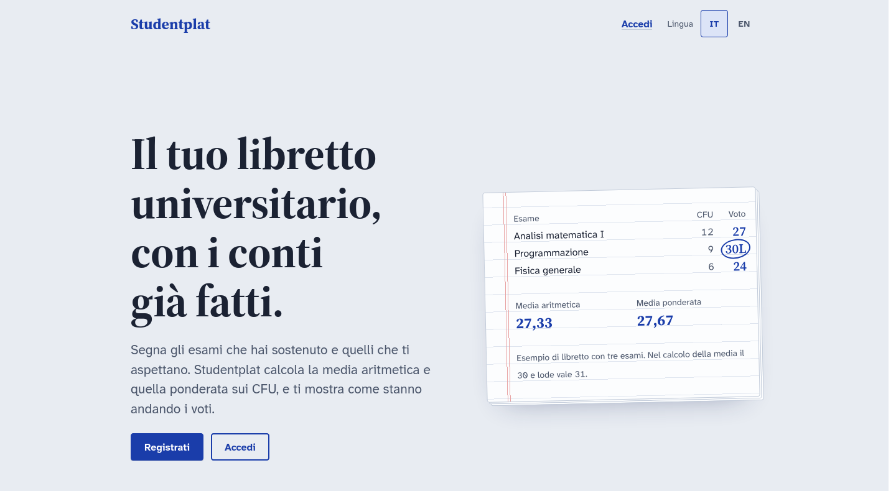

<div align="center">

# Studentplat

**Your university transcript online, with the maths already done.**

Log the exams you have passed and the ones still ahead: Studentplat works out your arithmetic and credit-weighted average, your graduation base score, and shows how your grades are trending.

[](https://svelte.dev)
[](https://svelte.dev/docs/kit)
[](https://mariadb.org)
[](https://nodejs.org)
[](../LICENSE)
[](#languages)

[Versione italiana](README.md) •
[Features](#features) •
[Install](#install) •
[Importing exams](#importing-exams) •
[Security](#security) •
[Development](#development) •
[Contributing](#contributing)



</div>

---

Studentplat does one thing: it keeps your transcript. No social feed, no shared notes, no gamification. Add an exam once, with its credits (CFU), and from then on every grade updates your averages, chart and statistics. A 30 cum laude counts as 31, just like in the university's own calculations.

Each user only sees and edits their own data. The project is meant to run locally, on your own machine, with a MariaDB or MySQL database.

## Features

- **A complete transcript.** Every exam with its credits, teacher, perceived difficulty and the history of every attempt: grade, withdrawn or absent, failed, grade rejected. An exam counts as passed only with a sufficient grade that was not rejected.
- **Always up-to-date averages.** Arithmetic average, credit-weighted average and graduation base score out of 110 (weighted x 110 / 30), recalculated with every grade.
- **Grade trend.** Exam-by-exam chart with the cumulative weighted average line, grade distribution by band and attempt outcomes, including the share of exams passed on the first try.
- **Exam calendar.** Monthly view to schedule, move or clear an exam session, record the outcome and create new exams on the spot.
- **Overview.** Your next three exam sessions and the credits earned against your degree total, as soon as you log in.
- **JSON import.** Bring in all your passed or upcoming exams at once instead of entering them one by one.
- **Shared catalogue.** Exams (name + credits) live in a common catalogue: whoever adds "Analisi matematica I, 12 CFU" makes it available to everyone, while grades and dates stay private.
- **Admin panel.** Site statistics, user management (role, closing sessions, deletion) and catalogue management, with merging of duplicates.
- **Italian and English.** The whole interface in both languages, with an always-visible switcher.
- **Light and dark theme.** Follows your system preference automatically.
- **Works without JavaScript.** Plain forms and two-step confirmations: the site stays usable with scripts disabled.

## Install

You need **Node.js 22+** and **MariaDB** or **MySQL**.

```sh
git clone https://github.com/Kerlooo/Studentplat.git
cd Studentplat
npm install
cp .env.example .env              # database credentials
mariadb -u <user> < db/schema.sql
npm run dev
```

The site runs at http://localhost:5173. The schema creates the `studentplat` database and all tables, and can be run again without losing data.

### Environment variables

| Variable      | Default       | Description       |
| ------------- | ------------- | ----------------- |
| `DB_HOST`     | `localhost`   | MySQL server host |
| `DB_PORT`     | `3306`        | MySQL server port |
| `DB_USER`     |               | MySQL user        |
| `DB_PASSWORD` | empty         | MySQL password    |
| `DB_NAME`     | `studentplat` | Database name     |

### First administrator

The admin role is assigned by hand, once. Further admins can then be appointed from the `/admin` panel.

```sql
UPDATE studentplat.users SET role = 'admin' WHERE email = 'you@example.com';
```

## Importing exams

From **Profile > Import exams** you paste a JSON list. Everything is validated before saving: with a single error nothing is written and the page points to the faulty row.

Passed exams (`grade` from 1 to 30, below 18 means failed; `"30L"` for cum laude, `null` for withdrawn or absent; `rejected` for a rejected grade):

```json
[
	{
		"name": "Analisi matematica I",
		"cfu": 12,
		"date": "2025-02-10",
		"grade": 28,
		"teacher": "Mario Rossi",
		"difficulty": "hard"
	},
	{ "name": "Programmazione", "cfu": 9, "date": "2025-06-20", "grade": "30L" },
	{ "name": "Fisica", "cfu": 6, "date": "2025-07-01", "grade": 24, "rejected": true }
]
```

Upcoming exams (the session date is optional):

```json
[
	{ "name": "Basi di dati", "cfu": 9, "date": "2026-01-28" },
	{ "name": "Sistemi operativi", "cfu": 12, "difficulty": "medium" }
]
```

Limits: 200 rows and 100 KB per import.

## Security

Authentication is written without external libraries, using only `node:crypto`.

- **Passwords:** scrypt hash with a random salt, constant-time comparison. Login takes the same time even when the email does not exist, so it does not reveal who is registered.
- **Sessions:** 256-bit random token in the cookie (`httpOnly`, `SameSite=Lax`, `Secure` outside development). The database only stores its SHA-256 hash: whoever reads the table cannot impersonate anyone.
- **Limited attempts:** after 5 wrong passwords for the same email, or 20 from the same address, login is blocked for 15 minutes.
- **Security headers:** Content Security Policy with nonces, clickjacking protection, `nosniff`. CSRF protection is SvelteKit's built-in one.
- **Isolated data:** every query on exams and attempts is filtered by the authenticated user, and every restricted page checks the session, not just the layout.

## Development

| Command           | Description             |
| ----------------- | ----------------------- |
| `npm run dev`     | Development server      |
| `npm run check`   | Type checking (JSDoc)   |
| `npm run lint`    | Prettier and ESLint     |
| `npm run format`  | Automatic formatting    |
| `npm run build`   | Production build (Node) |
| `npm run preview` | Preview the build       |

| Layer    | Technology                                                             |
| -------- | ---------------------------------------------------------------------- |
| Frontend | [Svelte 5](https://svelte.dev) (runes)                                 |
| Backend  | [SvelteKit 3](https://svelte.dev/docs/kit) with adapter-node           |
| Styling  | Plain CSS with custom properties, no framework                         |
| Database | MariaDB / MySQL via [mysql2](https://github.com/sidorares/node-mysql2) |

```
db/schema.sql              database schema
src/
  hooks.server.js          session, language and security headers
  lib/
    components/            Svelte components, one per file
    i18n/                  translations (it.json source, en.json)
    server/                database, authentication, queries
    stats.js               averages and statistics
  routes/
    dashboard/             restricted area: overview, calendar, transcript, stats, profile
    admin/                 admin panel
    login/                 log in and sign up
```

### Languages

Italian is the source language. Visible text is not written in components but in `src/lib/i18n/it.json` and `en.json`, with the same keys, used through `getT()`. A new key goes into both files.

## Contributing

Bug reports, ideas and pull requests are welcome: the rules are in [CONTRIBUTING.md](CONTRIBUTING.md#contributing-to-studentplat-english) and participants agree to the [code of conduct](CODE_OF_CONDUCT.md#code-of-conduct-english). Vulnerabilities must be reported privately, as described in [SECURITY.md](SECURITY.md#security-policy-english).

## License

[MIT](../LICENSE): you are free to use, modify and redistribute the project, as long as the author credit is kept.

## Author

Made by Kerlo (Carlo), a Computer Science and Technology student. Bug reports and suggestions are welcome in the [issues](https://github.com/Kerlooo/Studentplat/issues).
